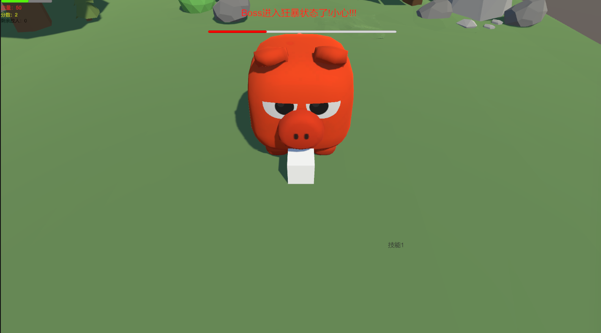
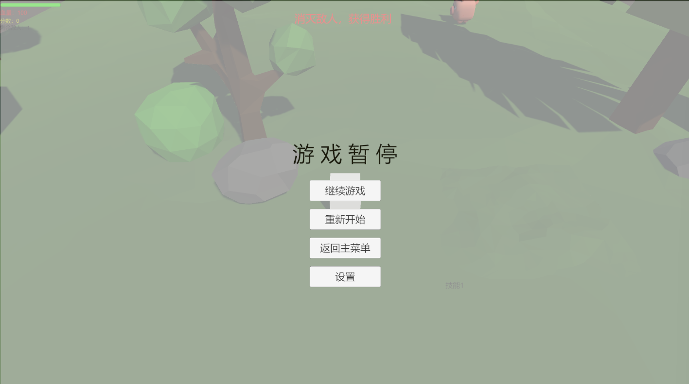
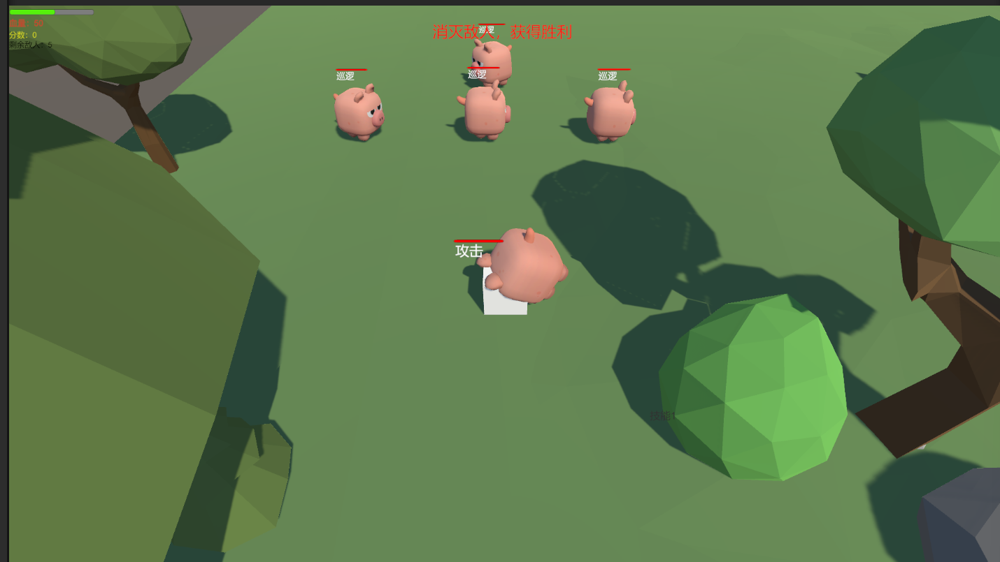
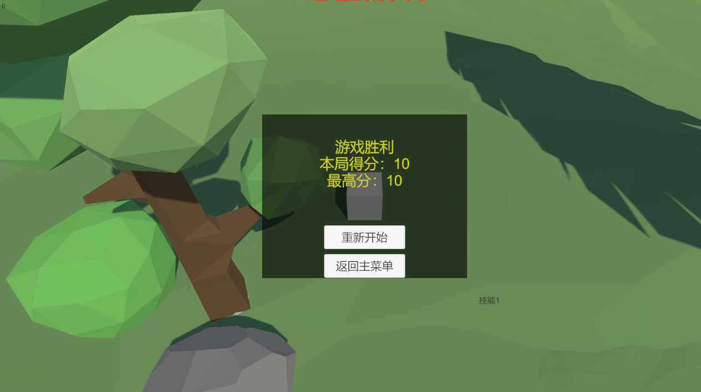

# 游戏 AI 演示

从零开始学习 Unity 游戏开发与游戏 AI，记录所有练习 Demo 和学习笔记。

## 当前作品：MiniLevel 小游戏（NavMesh 寻路版）

第三人称 3D 动作小游戏：在森林场景中击杀巡逻小怪、迎战 Boss。小怪与 Boss 基于有限状态机（FSM）+ NavMesh 真实寻路，会自动绕开树石、用扇形视野侦测玩家；每只小怪头顶独立血条与实时状态文字。包含完整的主菜单、暂停、设置（音量+音乐开关）、胜负结算和本地存档。

### 游戏截图

**主菜单**（最高分 / 最近得分本地存档）


**游戏中**（草地场景、小怪头顶血条与状态、树石障碍）


**Boss 登场**（清完小怪后登场，头顶血条）


**Boss 狂暴**（血量低于 30% 变红变大，攻速提升）



**暂停菜单**（Esc 暂停、设置、返回主菜单）



**小怪状态 UI**（每只小怪头顶血条 + 实时状态：巡逻/待机/追击/攻击）



**胜利结算**（本局得分 / 最高分 / 最近得分）



### 完整通关录屏

🎬 [点击在 Release 页在线观看 Demo1 演示视频（约 1 分 49 秒，含巡逻/扇形视野发现/NavMesh 绕障/攻击/脱战回血/Boss 登场导演/狂暴/胜利）](https://github.com/Csandjs/game-ai-demos/releases/tag/v0.2)

### 玩法

- **目标**：击杀全部小怪，最终击败 Boss
- **胜利条件**：击杀 Boss（10 点血量，血量低于 30% 进入狂暴）
- **失败条件**：玩家血量归零
- **登场机制**：小怪全部清空后，BossDirector 触发倒计时登场（自动把玩家逼退到安全距离）；五态有限状态机（待机/追击/攻击前摇/受击/死亡），攻击前摇 0.7 秒可躲避；30% 血进入狂暴，攻击提升、前摇缩短、变红变大

### 操作

| 按键 | 功能 |
|------|------|
| W A S D | 移动 |
| 空格 | 跳跃 |
| K / 鼠标左键 | 攻击（触发前扑动画，4 米范围内造成伤害） |
| Esc | 暂停 / 关闭设置面板 |

### 敌人 AI（有限状态机 FSM + NavMesh 寻路）

**小怪（Enemy）四态**：

- **Patrol 巡逻**：在 3 个可配置巡逻点之间移动，NavMesh 自动绕开树和石头
- **Idle 待机**：到达巡逻点后停留 2 秒，再前往下一个点
- **Chase 追击**：扇形视野（前方 60°、5 米）发现玩家后追击，速度随距离变化（远慢近快，1~4m/s）；8 米外丢失目标，返回巡逻并回满血
- **Attack 攻击**：贴脸（1.5 米）后站住，每 1 秒造成 10 点伤害

**Boss（Boss）五态**：

- **Idle 待机**：登场前待机
- **Chase 追击**：以 2m/s 追击（狂暴后 4m/s）
- **Attack 攻击**：3.5 米内前摇 0.7 秒（模型放大蓄力），造成 15 点伤害（狂暴 25），后摇 0.9 秒
- **Hurt 受击**：被击中硬直 0.4 秒（狂暴后攻击不会被打断）
- **Dead 死亡**：缩小消失，弹出胜利结算

**寻路方式**：NavMesh 真实寻路——NavMesh Surface 烘焙可行走区域，NavMeshAgent 接管移动，SetDestination 自动计算路径、绕开障碍物、自动转向；用 remainingDistance + stoppingDistance 判断是否到达。

### 技术亮点

- **NavMesh 真实寻路**：NavMesh Surface 烘焙可行走区域，NavMeshAgent 接管移动，SetDestination 自动绕开树/石头，替代手动 MoveTowards
- **小怪头顶世界空间 UI**：World Space Canvas + Billboard（LateUpdate 面向相机），每只怪独立血条（Slider）+ 实时状态文字，敌人转身时 UI 不转歪
- **扇形视野检测**：Vector3.Angle 判断玩家是否在前方 60° 锥内，可从背后偷袭
- **追击速度随距离 Lerp**：远慢近快，手感更自然
- **BossDirector 登场导演**：小怪清空后协程倒计时、逼退玩家、激活 Boss 与血条，控制登场节奏
- **剩余敌人数量 UI**：随生成与击杀实时刷新
- **双 AudioSource 音频系统**：一个喇叭 PlayOneShot 播一次性音效，一个喇叭 loop 播 BGM，独立开关互不干扰
- **事件驱动 UI**：金币、血量、Boss 血量通过 C# event / Action 通知，逻辑与界面解耦
- **存档系统**：PlayerPrefs + JSON 封装为 SaveManager，最高分/音量/音乐开关/关卡进度本地持久化
- **动画系统**：Animator 状态机（Idle/Move/Attack），SetFloat 驱动移动、Trigger 触发攻击，AnyState 过渡实现移动中攻击

## 目录结构

```
game-ai-demos/
├─ DailyPractice/                 # 每日 C# 控制台练习 + LeetCode
│  ├─ LeetCode/                   # 力扣刷题
│  ├─ Day14_Exam/                 # D14 闭卷自测：四件套角色系统
│  └─ Day14_Examples/             # D14 换皮练习：static / enum / 单例
├─ FristScene/                    # Unity 主项目（文件夹名沿用最初拼写）
│  └─ Assets/
│     ├─ Scenes/
│     │  ├─ MenuScene             # 主菜单（Build 0）
│     │  └─ MiniLevel             # 关卡（Build 1）
│     ├─ Scripts/
│     │  ├─ Player/               # 玩家移动、血量、攻击输入
│     │  ├─ Enemy/                # 小怪 AI、Boss AI、生成器、BossDirector
│     │  ├─ Items/                # 金币、陷阱
│     │  ├─ UI/                   # 菜单、血条、BossHpUI、结算、设置
│     │  └─ Game/                 # GameManager、AudioManager、SaveManager、GameConfig
│     ├─ Animations/              # 玩家动画控制器 + Attack.anim
│     ├─ Audio/                   # 音效 + BGM 素材
│     └─ Materials/               # 材质
├─ Helloworld/                    # C# 控制台 HelloWorld 入门项目
├─ selfintro/                     # 自我介绍练习
├─ notes/                          # 学习笔记与打卡记录
│  ├─ checkin.md                  # 每日打卡表
│  ├─ StudyNotes.md               # 每日学习笔记
│  ├─ cheatsheets.md              # 速查表
│  ├─ CSharp_Basics.md            # C# 基础笔记
│  ├─ week1.md                    # 第 1 周总结
│  ├─ week2.md                    # 第 2 周总结
│  ├─ week3.md                    # 第 3 周总结
│  └─ week4.md                    # 第 4 周总结
├─ Recordings/                    # 游戏录屏
├─ .gitignore
└─ README.md
```

## 阶段作品

- **MiniLevel（W4 整合版）**：完整可玩动作小游戏。主菜单 → 关卡，WASD 移动 / 空格跳跃 / K 攻击（Animator 四态动画），吃金币加分（事件驱动 UI），小怪三态 AI + Boss 五态 AI，双 AudioSource 音效+BGM，音乐开关存档，空气墙边界，Boss 出生点保护，胜负结算，音量+最高分+音乐开关 PlayerPrefs 存档。
- **MiniLevel（W3 整合作品）**：完整可玩小游戏。主菜单 → 关卡，WASD 移动 / 空格跳跃（Animator 动画），吃金币加分（事件驱动 UI），敌人 AI 三态（巡逻 / 追击 / 攻击），K 键反击，AudioManager 音效，胜负结算，音量 + 最高分 PlayerPrefs 存档。
- **MiniLevel（W2 里程碑）**：第一个完整可玩小关，镜头跟随、WASD 移动、空格跳跃（射线地面检测防空跳）、吃金币加分、终点弹胜利文字并锁定操作，全局由 GameManager 单例统一管理。
- **Practice_Rebuild**：空场景脱稿训练场，不看教程独立搭出刚体移动 + 触发检测。
- **Day14_Exam**：W2 闭卷自测，脱稿写出 Character 基类 + Player/Enemy 子类 + IDamageable 接口的回合制对战系统，一次跑通。

## 学习进度

### 第 1 周（W1）：C# 基础 + Unity 入门

- ✅ D1（9/3）：环境搭建 + GitHub 仓库 + C# HelloWorld
- ✅ D2（9/4）：Unity 安装 + 第一个场景 + 角色移动脚本
- ✅ D3（9/5）：简历骨架 + 打卡表 + 仓库整理
- ✅ D4（9/6）：C# 变量 / 类型 / 运算符 + Unity Transform 实操
- ✅ D5（9/8）：C# 条件 / 循环 + Unity 刚体物理移动与跳跃
- ✅ D6（9/9）：C# 数组 / 方法 + Unity 预制体 / 输入控制
- ✅ D7（9/10）：第一周复盘

### 第 2 周（W2）：面向对象 + 物理 + 可玩小关

- ✅ D8（9/11）：C# 面向对象 + 物理碰撞
- ✅ D9（9/12）：C# 继承 + 多态 + Unity 角色移动优化
- ✅ D10（9/13）：C# 多态 + 抽象类 + Unity 触发器 / 吃金币
- ✅ D11（9/14）：C# 接口 interface + Unity 接口实现
- ✅ D12（9/15）：封装 / 继承 / 多态 / 接口四件套整合 + 简单工厂
- ✅ D13（9/16）：C# 查漏（static / enum / namespace）+ 单例 + 可玩小关
- ✅ D14（9/17）：W2 复盘 + 闭卷自测（四件套 / static / enum / 单例）

### 第 3 周（W3）：委托事件 + 集合 + 动画 + UI + 整合

- ✅ D15（9/19）：委托 delegate / 事件 event / Action / Func + Unity 事件驱动
- ✅ D16（9/21）：Lambda + List 泛型集合 + Unity 批量生成管理
- ✅ D17（9/23）：Dictionary 字典 + Animator 动画 + 静态配置表
- ✅ D18（10/12）：Unity UI 系统（菜单 / 按钮 / Slider / 场景切换 / 暂停）
- ✅ D19（10/13）：状态机完善 + 主菜单设置 + PlayerPrefs 存档 + 事件解耦
- ✅ D20（10/14）：W3 整合，敌人 AI 状态机 + 玩家攻击 + 音效系统 + 完整流程

### 第 4 周（W4）：生命周期 + 协程 + 输入系统 + 场景存档 + 地基收官

- ✅ D21（10/15）：Unity 生命周期（Awake / Start / Update / FixedUpdate / LateUpdate / OnDestroy）
- ✅ D22（10/16）：协程 Coroutine（IEnumerator / yield return / WaitForSeconds / StopCoroutine）+ 技能 CD + BossDirector
- ✅ D23（10/17）：Input 系统 + 场景管理（SceneManager / 异步加载 / DontDestroyOnLoad）
- ✅ D24（10/17）：存档系统进阶（PlayerPrefs / JSON / SaveManager 整包存取）
- ✅ D25（10/18）：Boss 血条 / 攻击模式 / 死亡结算 + Input 移动闪避攻击 + Unity Recorder 录屏
- ✅ D26（10/18）：W4 复盘（速查表 + 闭卷自测 + 周总结 + 面试口述）
- ✅ D27（10/18）：地基期收官整合——攻击动画补全 + 试玩修 bug（空气墙 / 出生点保护）+ BGM 音乐开关存档 + 完整录屏 + README 更新

### 第 5 周（W5）：游戏 AI 专项——FSM 深化 + NavMesh 寻路

- ✅ D28：地基期阶段总结 + 游戏截图入 README + git tag v0.1 + GitHub Release
- ✅ D29：FSM 概念补课（状态转换图 + 控制台版状态机）
- ✅ D30：可配置巡逻点数组 + 到点停留（Idle）+ Gizmos 可视化 + 扇形视野（Vector3.Angle ±60°）+ 追击速度随距离变化
- ✅ D31：脱战回血 + Boss 狂暴（30% 血触发，变红变大）+ 金币模型掉落 + Enemy/Boss 动画 Idle/Run 联动
- ✅ D32：NavMesh 真实寻路（NavMesh Surface 烘焙 + NavMeshAgent 绕障）+ 小怪头顶世界空间血条与状态 UI（Billboard）+ Demo1 演示录屏

## 技术栈

- **语言**：C#
  - 面向对象：封装 / 继承 / 多态 / 接口 / 抽象类
  - 核心语法：流程控制、数组、方法、属性、static、enum、namespace、单例
  - 进阶：委托与事件、Lambda、List\<T>、Dictionary\<K,V>、协程 IEnumerator
- **引擎**：Unity（团结引擎 Tuanjie 1.10.2 / 编辑器 2022.3.62t14）
  - 物理：Rigidbody、Collider、OnCollision / OnTrigger、Raycast、空气墙
  - UI：UGUI（Canvas、Button、Text、Slider、Toggle、Panel）
  - 动画：Animator 状态机（Bool / Trigger 参数、AnyState 过渡、Transition Duration）
  - 音频：AudioSource（PlayOneShot / loop / mute）、AudioListener、双喇叭 AudioManager
  - 导航：NavMesh（NavMesh Surface 烘焙、NavMeshAgent、SetDestination、remainingDistance、Base Offset）
  - 其他：SceneManager 场景切换、PlayerPrefs 本地存档、协程、Unity Recorder 录屏
- **版本控制**：Git / GitHub
- **开发工具**：VS Code / Rider

## 后续计划

- 游戏 AI：状态机（已掌握）、NavMesh 寻路（已掌握）→ 行为树、A* 寻路原理、感知系统（听觉/团队警戒）
- 继续：2D / 3D 小游戏 Demo 开发
- 打磨期：public 字段重构为 [SerializeField] private、代码规范统一、性能优化
